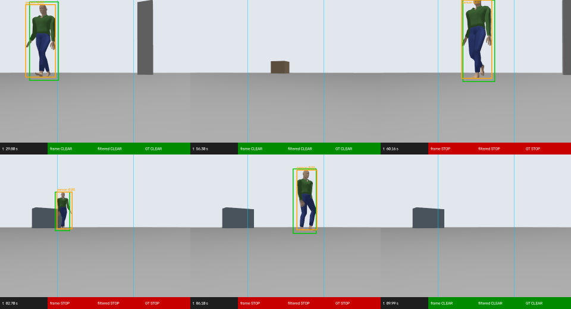
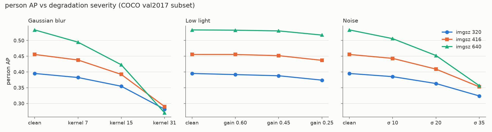
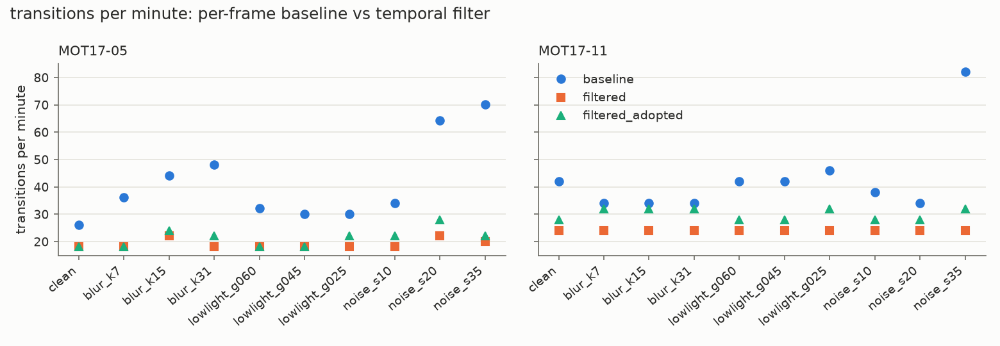
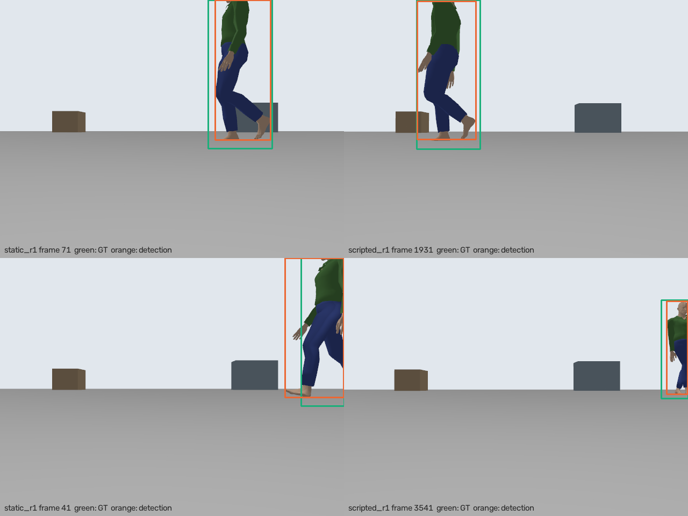
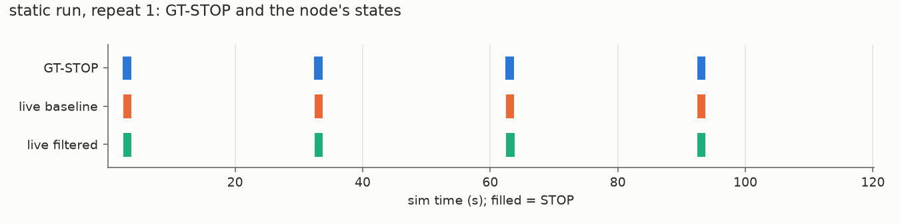

# visual-perception

**Camera-based person detection for a mobile robot: how it degrades, how to
stabilise it, and whether it holds up on a simulated TurtleBot3.** I measured
it on COCO, MOT17, and ROS 2 + Gazebo against ground truth, with every
number reproducible from saved runs.


<p align="center">
  
</p>
<p align="center"><sub>What the robot's perception node saw while I drove a TurtleBot3 Waffle Pi
through a Gazebo world with a walking person. Green: ground-truth box computed from the
simulator. Orange: the detector. Cyan: the region that counts for STOP. Banner: per-frame
state, filtered state, ground truth.</sub></p>

## Results at a glance

| | |
|---|---|
| **Robustness** (COCO, 750 images, 10 conditions) | Person AP at input 416 falls from 0.456 (clean) to 0.290 under heavy blur, 0.353 under heavy noise, 0.437 under heavy low light |
| **Latency** (laptop CPU, i7-13620H, batch 1) | 13.7 / 18.7 / 32.5 ms per image at input 320 / 416 / 640 |
| **Stability** (MOT17-05, moving camera, heavy noise) | The temporal filter cuts state changes from 70.3 to 22.1 per minute and false-STOP episodes from 14 to 2, at the cost of one missed event out of 9 |
| **On the robot** (Gazebo, 6 repeated runs) | Every ground-truth event detected, 0 false-STOP episodes, live node and offline bag replay agree on 100 % of processed frames |
| **Engineering** | 243 unit tests (no model weights needed), ROS parts in Docker, bit-exact bag replay (0 differing rows out of 21,848) |

<table>
  <tr>
    <td width="50%"></td>
    <td width="50%"></td>
  </tr>
  <tr>
    <td><sub><b>Blur hurts most, low light least.</b> Person AP falls at every severity step for every degradation and input size (COCO val2017 subset).</sub></td>
    <td><sub><b>The filter calms the safety signal in every condition</b>, most under noise, where the per-frame decision flickers hardest (MOT17).</sub></td>
  </tr>
  <tr>
    <td></td>
    <td></td>
  </tr>
  <tr>
    <td><sub><b>Ground truth from geometry, checked against the detector.</b> Boxes projected from the robot's true pose and a measured person volume: median IoU 0.766 with detections, never used for tuning.</sub></td>
    <td><sub><b>A live ROS 2 run.</b> Four crossings of the walking person, four STOP spans from the node, aligned with ground truth.</sub></td>
  </tr>
</table>

Full tables: [COCO](results/image_main/summary.md) ·
[MOT17](results/sequence_main/summary.md) ·
[simulation](results/sim/summary/summary.md) ·
[what the simulation runs show](docs/features/sim-runs.md#results).
Read them with [docs/limitations.md](docs/limitations.md).

## What this project is

A robot working near people needs to notice them, and real cameras do not
deliver clean images. I wanted to know three things about a small
pretrained detector (Ultralytics YOLO26n on a laptop CPU):

1. **Robustness:** how much it loses under blur, low light and sensor
   noise, at controlled strengths.
2. **Cost:** how inference latency depends on input size.
3. **Stability:** whether a temporal filter turns a flickering per-frame
   STOP / CLEAR signal into a stable one, and how much delay that adds.

I wrote the hypotheses down before running anything
([docs/design.md](docs/design.md)), fixed every threshold in advance, chose
data by ground truth only, tuned on one sequence and reported on others.

### Pipeline

```
image source ─► degradation ─► detector ─► decision ─► temporal filter ─► per_frame.csv
 (COCO, MOT17,   (blur, low      (YOLO26n)   (CLEAR /     (N-of-K +
  robot camera)   light, noise)               STOP /       release
                                              UNKNOWN)     hysteresis)
```

On the robot, a ROS 2 node runs **the same per-frame code** on the camera of
a TurtleBot3 Waffle Pi in Gazebo, while a scripted person walks a loop past
it:

```
Gazebo camera ─► ros_gz_bridge ─► perception_node ─► /perception/detections
                                   (same process_frame,  /perception/safety_state
                                    sim ROI, 2/3/3 filter)
keyboard teleop or scripted drive ─► cmd_guard (speed clamp, 0.5 s timeout) ─► /cmd_vel
rosbag ─► MOT17-layout export + ground truth from the simulator ─► offline replay
```

The safety state is published and measured, never fed back to the wheels.
How every part fits together: [docs/data-flow.md](docs/data-flow.md).

### What it covers

- **ROS 2 (rclpy):** perception node, command guard, run monitor and
  scripted driver; launch file with exit handlers; best-effort depth-1 QoS
  so stale frames are dropped; sim time for behaviour, the steady clock for
  watchdogs and timeouts; MCAP bag recording and export.
- **Gazebo Harmonic:** a world generated from YAML, an animated actor on a
  scripted path, a PosePublisher for true robot pose, headless rendering,
  a paused start so every run begins at sim time 0, an optional GUI for
  teleop.
- **Camera geometry:** pinhole projection of a measured person volume
  through the robot's true pose and camera mount, giving per-frame ground
  truth without hand labelling.
- **Perception evaluation:** COCO mAP with pycocotools, precision and
  recall at a fixed operating point, a detection-retention measure, event
  onset and release delays, false-STOP episodes, fault injection.
- **Data handling:** partial download of the 5.9 GB MOT17 archive through
  HTTP range requests (267 MB on disk), manifests and checksums instead of
  committed data.
- **Engineering:** a core package with no ROS dependency, 243 tests,
  Docker with GPU and X11 passthrough, generated figures and summaries,
  every run storing its config, environment and exact command.

## Quick start

```
uv sync                                    # Python 3.12 venv, CPU PyTorch
uv run pytest                              # unit tests, no model weights needed
uv run python scripts/fetch_coco_subset.py --n-person 14 --n-negative 6 --name smoke
uv run python scripts/run_image_experiment.py --config configs/smoke.yaml
```

The smoke test writes `results/smoke/per_frame.csv` (20 images × 10
conditions). Details: [docs/setup.md](docs/setup.md),
[docs/features/smoke-test.md](docs/features/smoke-test.md).

### Run the robot simulation

```
docker compose -f docker/compose.yaml build
uv run python scripts/run_sim.py --mode static --repeats 1 --prefix mystatic
```

One run takes about two minutes of simulated time in a fresh container and
leaves the node log in `results/sim/mystatic_r1/` and the bag in
`data/raw/sim/bags/mystatic_r1/`. Driving it yourself with the Gazebo window
open: [teleop demo](docs/features/sim-runs.md#teleop-demo). Watching a run
as an annotated video: [docs/features/sim-video.md](docs/features/sim-video.md).

## Reproduce the results and benchmark your device

Step-by-step recreation of each phase, with a check after every step:

- Phase 1: [docs/plans/phase-1-offline-pipeline.md](docs/plans/phase-1-offline-pipeline.md#recreate-phase-1-and-check-it-yourself)
- Phase 2: [docs/plans/phase-2-experiments.md](docs/plans/phase-2-experiments.md#recreate-phase-2-and-check-it-yourself)
- Phase 3: [docs/plans/phase-3-ros2-sim.md](docs/plans/phase-3-ros2-sim.md#recreate-phase-3-and-check-it-yourself)

Quick device benchmark (750 COCO images, three input sizes), compared with
the reference machine:

```
uv run python scripts/fetch_coco_subset.py --n-person 500 --n-negative 250 --name main
uv run python scripts/run_image_experiment.py --config configs/benchmark.yaml
uv run python scripts/evaluate_image_experiment.py --run results/benchmark
uv run python scripts/compare_runs.py --reference results/image_main --candidate results/benchmark
```

`compare_runs.py` checks that your accuracy numbers match the committed run
and prints your latency next to the reference.

## Status

| Phase | Content | State |
|---|---|---|
| 1 | Offline pipeline: degradations, detector, decision, temporal filter, run outputs, smoke test | done |
| 2 | COCO image experiment and MOT17 sequence experiment, filter sweep, fault injection | done |
| 3 | ROS 2 Jazzy + Gazebo Harmonic (Docker), TurtleBot3 camera feeding a perception node, repeated runs, bag replay, teleop demo | done |
| 4 | CPU vs GPU latency on a second machine | planned |
| 5 | Final report | planned |

## Documentation

- [docs/design.md](docs/design.md): questions, hypotheses, fixed parameters
- [docs/data-flow.md](docs/data-flow.md): data flow, components, tests
- [docs/features/](docs/features/README.md): one page per stage and tool
- [docs/limitations.md](docs/limitations.md): what the results can and cannot support
- [docs/troubleshooting.md](docs/troubleshooting.md): problems I ran into
  while building this, and what to avoid

## Layout

```
configs/    experiment configs (YAML); configs/sim/ for the simulation world
data/       manifests (committed) and raw data (git-ignored)
docker/     ROS 2 Jazzy + Gazebo image, compose file, run scripts
docs/       design, setup, per-feature notes, plans
models/     detector weights (downloaded, git-ignored)
results/    run outputs (final runs only are committed)
scripts/    command-line entry points
ros2_ws/    ROS 2 package rvp_ros: nodes, launch file, generated world
src/robust_visual_perception/   core package (no ROS dependency)
tests/      pytest unit tests (no ROS needed)
```

## Scope and limits

- The STOP state is an image-space heuristic ("a confident person detection
  is in view"). It does not estimate distance and is not collision
  avoidance.
- Degradations are synthetic and applied one at a time.
- The simulated scene is clean and easy; it shows the pipeline working on a
  robot camera, not performance on real robot images.
- No training or fine-tuning; the detector is used as shipped.

## License

AGPL-3.0, matching Ultralytics, which this project depends on.
